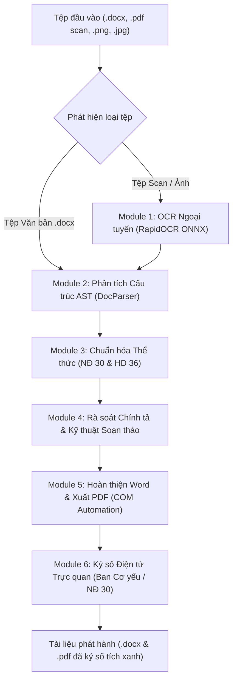
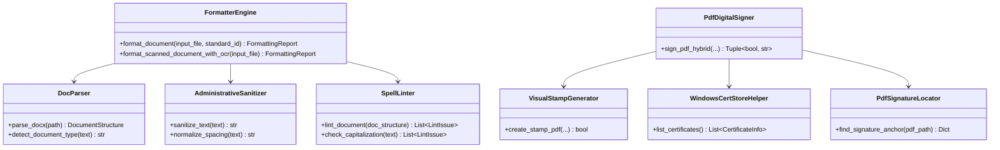

# TÀI LIỆU ĐẶC TẢ KỸ THUẬT HỆ THỐNG
## CÔNG CỤ TỰ ĐỘNG CHUẨN HÓA THỂ THỨC VĂN BẢN ĐẢNG & HÀNH CHÍNH
### (Auto-Formatter Version 1.0 — Chạy Ngoại Tuyến 100% • Tích Hợp OCR & Ký Số Điện Tử)

---

## I. TỔNG QUAN DỰ ÁN (PROJECT OVERVIEW)

### 1. Bối cảnh & Mục đích
Trong hoạt động của các cơ quan Đảng, tổ chức chính trị - xã hội và cơ quan hành chính Nhà nước, thể thức và kỹ thuật trình bày văn bản là tiêu chí bắt buộc phản ánh tính pháp lý, tính trang nghiêm và chuẩn mực công vụ. Tuy nhiên, việc soạn thảo thực tế thường gặp các tồn tại:
* Vi phạm quy chuẩn căn lề, khoảng cách dòng, khoảng cách đoạn, phông chữ, cỡ chữ, kiểu chữ.
* Sai sót trong cách trình bày Quốc hiệu, Tiêu ngữ, Tên cơ quan ban hành, Số ký hiệu, Trích yếu nội dung, Khối chữ ký và Nơi nhận.
* Tồn tại nhiều lỗi kỹ thuật soạn thảo: khoảng trắng kép, thiếu khoảng trắng sau dấu câu, khoảng trắng trước dấu câu, viết hoa tùy tiện danh từ chung hoặc quên viết hoa tên riêng cơ quan, tổ chức.
* Khó khăn trong việc xử lý các tài liệu cũ dạng ảnh chụp hoặc PDF scan cần số hóa lại.
* Nhu cầu cấp thiết về ký số văn bản điện tử theo đúng thể thức Nghị định 30/2020/NĐ-CP và tương thích với USB Token chuyên dùng của Ban Cơ yếu Chính phủ.

**Auto-Formatter 1.0** được phát triển nhằm mục tiêu giải quyết triệt để các vấn đề trên, cung cấp giải pháp trọn gói từ khâu tiếp nhận dự thảo, chuẩn hóa tự động, rà soát lỗi kỹ thuật đến khâu ký số điện tử và phát hành.

### 2. Các Quy chuẩn Pháp lý Tuân thủ
Hệ thống tuân thủ nghiêm ngặt 2 bộ quy chuẩn nền tảng của hệ thống chính trị Việt Nam:
1. **Nghị định số 30/2020/NĐ-CP** ngày 05/3/2020 của Chính phủ về công tác văn thư (Áp dụng cho khối cơ quan hành chính Nhà nước, đơn vị sự nghiệp công lập, doanh nghiệp Nhà nước).
2. **Hướng dẫn số 36-HD/VPTW** ngày 03/4/2018 của Văn phòng Trung ương Đảng về thể thức và kỹ thuật trình bày văn bản của Đảng (Áp dụng cho khối các cơ quan, tổ chức Đảng các cấp).

---

## II. ĐẶC TẢ CÁC TÍNH NĂNG VÀ CHỨC NĂNG CỐT LÕI



### Module 1: Xử lý OCR Ngoại tuyến (Offline OCR Engine)
* **Mục tiêu**: Số hóa và nhận dạng ký tự quang học từ văn bản scan hoặc ảnh chụp tài liệu mà không cần gửi dữ liệu lên máy chủ bên thứ ba.
* **Tính năng chi tiết**:
  * Nhận dạng đa định dạng: tệp PDF scan nhiều trang, tệp ảnh TIFF, PNG, JPG.
  * Tích hợp bộ mô hình học sâu `RapidOCR` trên nền tảng `ONNX Runtime` tối ưu hóa cho kiến trúc CPU x64.
  * Tự động tiền xử lý ảnh: làm thẳng góc nghiêng, tăng cường độ tương phản, khử nhiễu bảng biểu.
  * Tái cấu trúc lại luồng văn bản tiếng Việt có dấu với độ chính xác cao (> 97%), tự động đưa vào quy trình chuẩn hóa thể thức.

### Module 2: Phân tích & Chuẩn hóa Cấu trúc Thể thức (Layout & Format Normalizer)
* **Mục tiêu**: Đưa toàn bộ các thành phần thể thức về đúng kích thước, vị trí và kiểu chữ theo quy định pháp luật.
* **Tính năng chi tiết**:
  * **Khổ giấy & Căn lề chuẩn A4**:
    * Lề trên: 20 – 25 mm.
    * Lề dưới: 20 – 25 mm.
    * Lề trái: 30 – 35 mm (phục vụ đóng gáy hồ sơ).
    * Lề phải: 15 – 20 mm.
  * **Phông chữ & Giãn cách chuẩn**: Phông chữ Times New Roman bộ mã Unicode tiêu chuẩn (TCVN 6909:2001); giãn cách dòng Multiple 1.15 – 1.25 pt (hoặc Exactly 18 – 20 pt), khoảng cách giữa các đoạn Spacing Before/After 4 – 6 pt.
  * **Phân định và định dạng 9 thành phần thể thức chính**:
    1. *Quốc hiệu và Tiêu ngữ*: Chữ in hoa đứng đậm, dòng Tiêu ngữ chữ hoa thường đứng đậm, có đường kẻ ngang bằng độ dài tiêu ngữ.
    2. *Tên cơ quan, tổ chức ban hành*: Cấp trên chữ in hoa thường đứng; cơ quan trực tiếp chữ in hoa đứng đậm, có đường gạch chân phân cách.
    3. *Số, ký hiệu văn bản*: Trình bày đúng thể thức chữ hoa đứng, phân cách bằng dấu gạch chéo `/`.
    4. *Địa danh và ngày, tháng, năm ban hành*: Chữ in thường nghiêng, căn giữa dưới Quốc hiệu - Tiêu ngữ.
    5. *Tên loại và Trích yếu nội dung*: Tên loại văn bản in hoa đứng đậm; trích yếu in thường đứng đậm.
    6. *Nội dung văn bản*: Thụt lề đầu dòng 1 – 1.27 cm (First Line Indent); căn đều hai lề (Justify); phân cấp số thứ tự Điều, Khoản, Điểm đúng quy định.
    7. *Chức vụ, họ tên và chữ ký*: Căn góc phải, quyền hạn in hoa đứng đậm, chức vụ in hoa đứng đậm, họ tên in thường đứng đậm; có khoảng trống ký chuẩn hóa.
    8. *Con dấu và Chữ ký số*: Vị trí trùm 1/3 chữ ký về bên trái.
    9. *Nơi nhận*: Căn góc trái, chữ in thường nghiêng đậm, các dòng địa chỉ nhận cỡ chữ 11 – 12 pt, gạch đầu dòng chuẩn.

### Module 3: Rà soát Lỗi Chính tả Hành chính & Kỹ thuật Soạn thảo (Administrative Linter)
* **Mục tiêu**: Bóc tách, phân loại và hiển thị trực quan các lỗi vi phạm trong tài liệu.
* **Hệ thống 4 Thẻ Phân loại Lỗi (Interactive Filter Cards)**:
  1. **Đoạn văn chuẩn hóa**: Thống kê số lượng đoạn văn được tái lập lề, khoảng cách dòng và phông chữ.
  2. **Khoảng trắng dọn dẹp**: Phát hiện khoảng trắng liên tiếp, khoảng trắng ở đầu/cuối đoạn văn, dấu tab thừa.
  3. **Chính tả & Dấu câu**: Kiểm tra quy tắc đặt dấu câu trong tiếng Việt (dấu phẩy, chấm, chấm phẩy, hai chấm phải viết liền sát từ đứng trước và cách 1 khoảng trắng với từ kế tiếp).
  4. **Cảnh báo viết hoa**:
     * Cảnh báo danh từ chung viết hoa tùy tiện khi không đi kèm tên riêng (ví dụ: *các Chi bộ* -> *các chi bộ*).
     * Cảnh báo quên viết hoa đúng tên cơ quan, tổ chức Nhà nước và Đảng (ví dụ: *bộ y tế* -> *Bộ Y tế*, *ban chấp hành trung ương* -> *Ban Chấp hành Trung ương*).
* **Bảng báo cáo chi tiết**: Cho phép cán bộ bấm vào từng thẻ để lọc riêng từng loại lỗi, đối chiếu nội dung gốc, nội dung đề xuất chuẩn hóa và viện dẫn căn cứ pháp lý.

### Module 4: Tự động Xuất PDF & Quản lý COM Automation
* Tích hợp nền tảng tương tác MS Word COM (`pywin32`) chạy nền ẩn:
  * Đảm bảo ngắt trang (Page Breaks), căn chỉnh bảng biểu (Tables) và chân trang (Footers) 100% trung thực theo engine Word của máy tính.
  * Tự động xuất tệp PDF định dạng chuẩn in ấn (PDF/A) chỉ trong vài giây.

### Module 5: Ký số Điện tử Trực quan (Visual Digital Signature Engine)
* **Mục tiêu**: Thực hiện ký số điện tử chuẩn Nghị định 30/2020/NĐ-CP và tương thích tuyệt đối với hạ tầng chứng thư số Ban Cơ yếu Chính phủ.
* **Mô hình Kiến trúc Lai (Hybrid Signing Architecture)**:
  * **Kênh 1: Ký số trực tiếp bằng USB Token (Native PAdES / CAPI)**:
    * Giao tiếp trực tiếp với USB Token cắm vào máy tính thông qua Windows CryptoAPI (`Crypt32.dll`).
    * Hỗ trợ ký mật mã SHA-256 with RSA (PKCS#7) kèm hiển thị hộp thoại PIN gốc của nhà sản xuất Token.
    * Tạo tệp PDF kết quả có **Dấu Tích Xanh Hợp Lệ (Signature Valid)** khi mở trên Adobe Acrobat, Foxit PDF và phần mềm quản lý văn bản điều hành.
  * **Kênh 2: Cầu nối phần mềm Ban Cơ yếu Chính phủ (VGCA SignTool Bridge)**:
    * Tự động phát hiện dịch vụ hoặc phần mềm ký số Ban Cơ yếu (`vgca_sign.exe`, `vsign.exe`) trên các cổng cục bộ (8080, 8443, 2104...).
    * Tự động kích hoạt chuyển giao tài liệu sang phần mềm chuyên dùng khi cán bộ yêu cầu.
* **Trình xem trước PDF và Chọn vị trí ký tương tác trực quan (Interactive PDF Canvas)**:
  * Tích hợp công nghệ kết xuất PDF bản địa (`PyQt6.QtPdf` / `QPdfDocument`) hiển thị hình ảnh trang tài liệu cực nét, tốc độ siêu tốc.
  * Cho phép **nhấp chuột bất kỳ đâu** trên trang để chuyển tâm chữ ký đến đó.
  * Cho phép **kéo thả chuột (Drag & Drop)** khung chữ ký trên màn hình để căn chỉnh chính xác từng milimét.
  * Hiển thị **xem trước thời gian thực (Live Preview)**: Chữ ký tay màu xanh + dòng thông tin ngày giờ ký, hoặc con dấu đỏ tròn tỷ lệ 1:1 theo Điều 13 NĐ 30.
* **Bộ Định vị Khối Ký Thông Minh (Smart Signature Locator)**:
  * Tự động quét cấu trúc trang để nhận diện các dòng thẩm quyền: `T/M BAN THƯỜNG VỤ`, `BÍ THƯ`, `CHỦ TỊCH`, `GIÁM ĐỐC`, `THỦ TRƯỞNG`... và khối `Nơi nhận:`.
  * **Phân biệt thông minh**: Bỏ qua các trang phụ lục, bảng biểu danh sách đính kèm (`DANH SÁCH...`, `PHỤ LỤC...`) để nhảy chính xác về trang kết thúc văn bản chính và đặt khung ký ngay giữa chức danh và họ tên.

---

## III. THIẾT KẾ KIẾN TRÚC VÀ CẤU TRÚC MÃ NGUỒN

### 1. Sơ đồ Cấu trúc Thư mục Dự án

```
d:\AutoFormatter\
├── assets\                          # Tài nguyên đồ họa, Icon & Vector
│   ├── app_icon.ico                 # Icon ứng dụng định dạng Windows
│   └── icons\                       # 23 bộ biểu tượng SVG và PNG đa độ phân giải
├── config\                          # Tầng cấu hình và Từ điển nghiệp vụ
│   ├── administrative_dictionary.json # Từ điển từ ngữ, tên cơ quan, quy tắc viết hoa
│   ├── agency_profiles.json         # Danh mục hồ sơ cơ quan ban hành tùy biến
│   └── standards\                   # Tệp cấu hình thể thức YAML
│       ├── nd30_2020.yaml           # Quy chuẩn Nghị định 30/2020/NĐ-CP
│       └── hd36_vptw.yaml           # Quy chuẩn Hướng dẫn 36-HD/VPTW
├── core\                            # Tầng Logic nghiệp vụ cốt lõi (Core Engine)
│   ├── administrative_sanitizer.py  # Chuẩn hóa văn bản hành chính & nội dung
│   ├── com_helper.py                # Wrapper Microsoft Word COM Automation
│   ├── doc_parser.py                # Phân tích cú pháp AST và nhận diện cấu trúc
│   ├── formatter_engine.py          # Bộ máy thực thi chuẩn hóa tài liệu chính
│   ├── header_footer_builder.py     # Xây dựng Tiêu đề trên / Tiêu đề dưới / Số trang
│   ├── ocr_engine.py                # Bộ máy OCR bóc tách ảnh/PDF ngoại tuyến (RapidOCR)
│   ├── path_utils.py                # Tiện ích quản lý đường dẫn thư mục
│   ├── signature_engine.py          # Bộ máy Ký số Điện tử Ban Cơ yếu & NĐ 30
│   ├── spell_linter.py              # Bộ rà soát lỗi chính tả & dấu câu & viết hoa
│   └── win32_helper.py              # Xử lý nền đa luồng với Windows API
├── ui\                              # Tầng Giao diện người dùng (PyQt6 UI)
│   ├── icon_factory.py              # Nhà máy cung cấp và đệm biểu tượng High-DPI
│   ├── main_window.py               # Cửa sổ ứng dụng chính (Dashboard điều khiển)
│   ├── profile_dialog.py            # Hộp thoại quản lý danh mục cơ quan ban hành
│   ├── signature_dialog.py          # Hộp thoại ký số tương tác trực quan trên PDF
│   └── styles.py                    # Bảng định dạng QSS hiện đại chuẩn công vụ
├── build_exe.spec                   # Cấu hình biên dịch đóng gói PyInstaller tối ưu
├── main.py                          # Điểm khởi nhập (Entry Point) của ứng dụng
└── dist\                            # Sản phẩm xuất xưởng sẵn sàng phân phối
    ├── AutoFormatter\               # Bản Onedir mở tức thì (< 1 giây)
    │   └── AutoFormatter.exe
    └── AutoFormatter_v1.0.zip       # Gói nén di động (Portable 137 MB)
```

### 2. Các Lớp Đối tượng (Class Diagram) Tiêu biểu



---

## IV. BẢO MẬT & ĐỘC LẬP TÁC CHIẾN (SECURITY & INDEPENDENCE)

### 1. Nguyên tắc An toàn Thông tin
* **100% Offline (Không kết nối Internet)**:
  * Ứng dụng không mở bất kỳ kết nối mạng ra bên ngoài, không gửi báo cáo telemetry hay sử dụng Cloud API.
  * Tuyệt đối an toàn để xử lý các tài liệu mật, tài liệu nội bộ của Đảng và cơ quan Nhà nước.
* **Bảo vệ Khóa Bí mật (Private Key Security)**:
  * Không bao giờ trích xuất khóa riêng ra khỏi phần cứng USB Token.
  * Việc ký số được ủy thác hoàn toàn cho bộ điều khiển mật mã của hệ điều hành Windows CryptoAPI và vi mạch bảo mật trong thẻ Token (chuẩn FIPS 140-2 Level 2/3).

### 2. Tối ưu hóa Hiệu năng & Đóng gói Phân phối
* **Khởi động tức thì (< 1 giây)**:
  * Sử dụng cấu trúc đóng gói Onedir (thư mục ứng dụng đã giải nén sẵn nhị phân), loại bỏ hoàn toàn thời gian trễ giải nén file tạm vào `%TEMP%` của các gói đơn lẻ cũ.
  * Tách biệt các thư viện nặng thông qua kỹ thuật lazy loading: chỉ tải mô hình OCR và thư viện ký số khi người dùng kích hoạt chức năng tương ứng.
* **Gói nén phân phối gọn nhẹ**:
  * Đã loại trừ triệt để các thư viện thừa (`matplotlib`, `scipy`, `pandas`, `IPython`, `tkinter`...).
  * Toàn bộ ứng dụng bao gồm cả giao diện PyQt6, bộ mô hình AI OCR và công cụ ký số được nén trong tệp zip duy nhất **137 MB**, có thể chép vào USB chạy ngay mà không cần cài đặt.

---

## V. HƯỚNG DẪN BÀN GIAO & VẬN HÀNH

1. **Khởi chạy ứng dụng**:
   * Mở thư mục `dist/AutoFormatter/` và chạy trực tiếp file `AutoFormatter.exe` (hoặc giải nén từ `dist/AutoFormatter_v1.0.zip`).
2. **Quy trình chuẩn hóa**:
   * Kéo thả tệp dự thảo `.docx` hoặc tệp scan `.pdf` vào vùng thả giữa màn hình.
   * Chọn Quy chuẩn: **Hành chính Nhà nước (NĐ 30/2020)** hoặc **Cơ quan Đảng (HD 36-HD/VPTW)**.
   * Bấm nút **"BẮT ĐẦU CHUẨN HÓA THỂ THỨC"**.
   * Quan sát bảng thống kê 4 thẻ lỗi và báo cáo chi tiết.
3. **Quy trình ký số**:
   * Bấm nút **"Ký số (NĐ 30)"**.
   * Cửa sổ xem trước PDF hiện ra, vị trí ô ký được tự động đề xuất tại đúng trang và dòng ký. Cán bộ có thể nhấp chuột hoặc kéo thả để điều chỉnh nếu muốn.
   * Cắm USB Token Ban Cơ yếu, chọn chứng thư và bấm **"THỰC HIỆN KÝ SỐ VĂN BẢN"** để hoàn tất văn bản có dấu tích xanh.
